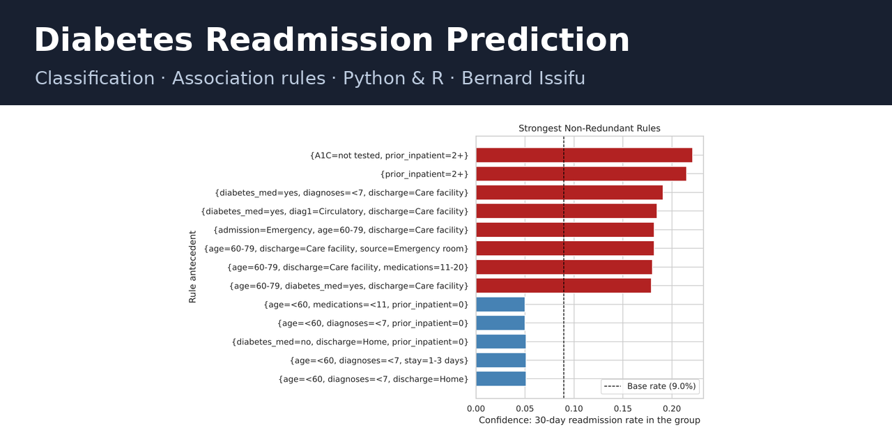

# Predicting 30-Day Hospital Readmission for Patients with Diabetes

A data science project on predicting which patients with diabetes will be readmitted to hospital within
30 days of discharge, using 101,766 hospital encounters from 130 US hospitals. It combines
classification models with association rule mining to identify the patients and patient profiles at
highest risk. Every analysis is implemented in both **Python** and **R**.

## Dataset

**Diabetes 130-US Hospitals for Years 1999–2008** (UCI Machine Learning Repository, dataset 296,
CC BY 4.0). Strack, B. et al. (2014). *Impact of HbA1c Measurement on Hospital Readmission Rates:
Analysis of 70,000 Clinical Database Patient Records.* BioMed Research International.

- `data/diabetic_data.csv`: 101,766 hospital encounters × 50 columns
- `data/IDS_mapping.csv`: labels for the admission type, discharge disposition and admission source codes
- `data/processed/`: cleaned data written by Part 1 (not committed; run Part 1 first, then Parts 2–3)

## Questions

1. **Which patient and hospital-stay factors best predict readmission within 30 days?**
   Classification: logistic regression, decision tree and random forest, handling the imbalanced
   outcome, evaluated with ROC-AUC, recall and precision.
2. **Which combinations of patient characteristics and treatments are associated with early
   readmission?** Association rule mining (Apriori) with `readmitted <30` as the consequent, ranked by
   lift.

## Contents

| Part | Python | R |
|---|---|---|
| 1. Data preparation and exploratory analysis | [`python/01_data_preparation_eda.ipynb`](python/01_data_preparation_eda.ipynb) | [`r/01_data_preparation_eda.Rmd`](r/01_data_preparation_eda.Rmd) ([HTML](r/01_data_preparation_eda.html)) |
| 2. Question 1: predicting readmission (classification) | [`python/02_q1_classification.ipynb`](python/02_q1_classification.ipynb) | [`r/02_q1_classification.Rmd`](r/02_q1_classification.Rmd) ([HTML](r/02_q1_classification.html)) |
| 3. Question 2: association rules | [`python/03_q2_association_rules.ipynb`](python/03_q2_association_rules.ipynb) | [`r/03_q2_association_rules.Rmd`](r/03_q2_association_rules.Rmd) ([HTML](r/03_q2_association_rules.html)) |

**Report:** [`report/issifu_bernard_finalprojectreport.pdf`](report/issifu_bernard_finalprojectreport.pdf)
(5 pages; Markdown source and `build_report.sh` alongside). Document-kit (LaTeX) style:
[`report/kit-version/issifu_bernard_finalprojectreport.pdf`](report/kit-version/issifu_bernard_finalprojectreport.pdf),
built from the Markdown in that folder with a Pandoc + XeLaTeX document template. Figures and result tables from both
languages are in `report/figures/`.

## Key results

- **Data:** 69,987 patients after cleaning (first stay each), 8.98% readmitted within 30 days. Python
  and R produce the identical cleaned dataset.
- **Question 1:** test ROC-AUC 0.640 (logistic regression), 0.634 (decision tree), 0.647 (random forest);
  R gives 0.642 / 0.620 / 0.647. Discharge destination and prior inpatient visits are the strongest
  predictors; discharge home has 0.45 times the odds of discharge to a care facility.
- **Question 2:** 77 higher-risk and 65 lower-risk non-redundant rules (identical in Python and R).
  Two or more prior inpatient stays: 21.5% readmitted (lift 2.39). Younger patients discharged home with
  no prior stay: about 5% (lift 0.56–0.59).

## How to run

- **Python:** from `python/`, run the notebook top to bottom (pandas, numpy, matplotlib, seaborn;
  scikit-learn and mlxtend for Parts 2–3).
- **R:** from `r/`, render each file in order with `rmarkdown::render("01_data_preparation_eda.Rmd")`
  and so on (dplyr, tidyr, ggplot2; rpart, randomForest, pROC and arules for Parts 2–3).
- **Report:** from `report/`, run `./build_report.sh` (needs pandoc and Chromium).
