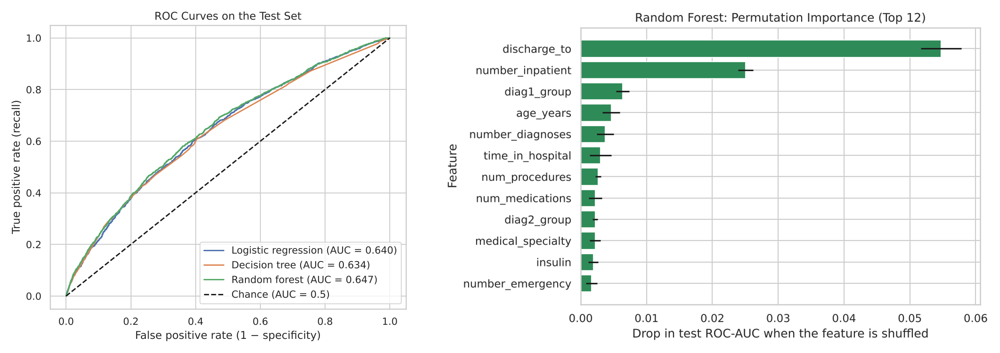
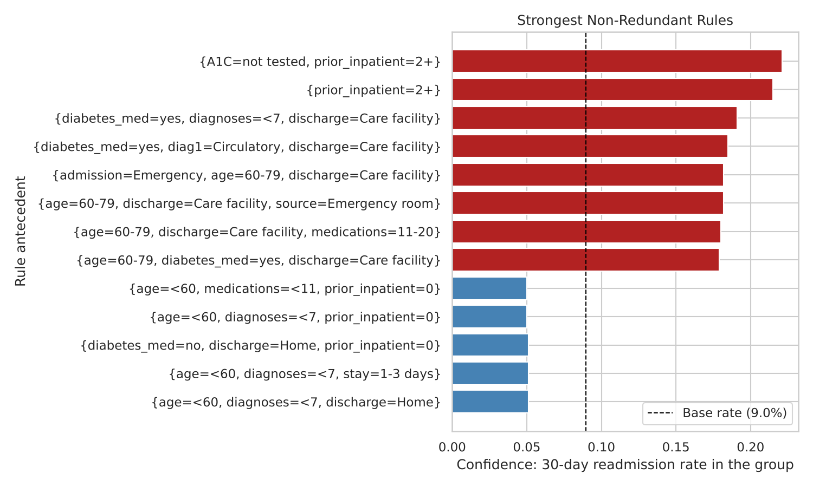

# Introduction

Hospital readmission within 30 days of discharge is costly, often preventable, and used in the United
States as a measure of hospital quality. Patients with diabetes are readmitted more often than most,
because diabetes complicates recovery from almost any illness. This report uses the **Diabetes 130-US
Hospitals for Years 1999–2008** dataset (Strack et al., 2014; UCI Machine Learning Repository, CC BY 4.0),
which records 101,766 inpatient stays of patients with diabetes at 130 US hospitals. Each stay is
described by the patient's age band, gender and race; the admission type and source and the discharge
destination; the length of stay and numbers of lab tests, procedures, medications and diagnoses; the
patient's outpatient, emergency and inpatient visits in the previous year; up to three ICD-9 diagnosis
codes; two glucose tests (HbA1c and serum glucose); and the status of 23 diabetes medications. The
outcome records whether the patient was readmitted within 30 days, after 30 days, or not at all.

To prepare the data, stays ending in death or hospice care were removed (those patients cannot be
readmitted), and only each patient's first stay was kept, so that every patient counts once. `weight`
(97% missing) and the payer code were dropped, missing race and medical specialty became their own
categories, the glucose tests' "not performed" value was kept as a category, and the 700+ diagnosis
codes were grouped into nine clinical categories. The cleaned data contain **69,987 patients** and no
missing values; **8.98%** were readmitted within 30 days. All analysis was done twice, in Python and in
R, with matching results.

# Question 1: Which factors best predict readmission within 30 days?

## Introduction

If a hospital could tell at discharge which patients are likely to return within a month, it could
target follow-up calls, medication reviews or home visits at them. This question asks how well the
recorded patient and hospital-stay information predicts 30-day readmission, and which factors drive the
prediction. It uses 25 predictors (demographics, admission and discharge details, stay measures,
prior-year visits, diagnosis groups, glucose tests and diabetes medications) and the binary outcome
*readmitted within 30 days* (yes or no). I am interested in it because it turns a large administrative
dataset into something a care team could act on.

## Approach

Three classifiers were compared. **Logistic regression** is a transparent baseline whose coefficients,
expressed as odds ratios, show each factor's direction and size of effect. A **decision tree** (depth 6,
at least 100 patients per leaf) gives readable rules. A **random forest** (300 trees) captures
interactions and non-linear effects. Numeric features were standardized (z-scores) so coefficients are
comparable, and the three heavily right-skewed visit counts were log-transformed first. Categorical
features were one-hot encoded with a reference level. Because only 9% of patients are readmitted, a
model predicting "no" for everyone would be 91% accurate and useless, so each model weighted the classes
equally and was judged by **ROC-AUC** (how well it ranks readmitted patients above others), **recall**
(share of readmissions flagged) and **precision** (share of flagged patients actually readmitted). The
data were split 80/20, stratified on the outcome, with 5-fold cross-validation on the training set.
Feature importance was measured by odds ratios and by **permutation importance** (the drop in test
AUC when one feature is shuffled).

## Data analysis and results

| Model | CV ROC-AUC | Test ROC-AUC | Recall | Precision | Share flagged | Test ROC-AUC (R) |
|-------------------|-------------|--------|------|--------|--------|--------|
| Logistic regression | 0.639 ± 0.004 | 0.640 | 0.539 | 0.135 | 0.359 | 0.642 |
| Decision tree | 0.627 ± 0.006 | 0.634 | 0.567 | 0.129 | 0.395 | 0.620 |
| Random forest | 0.646 ± 0.007 | **0.647** | 0.348 | **0.165** | 0.190 | 0.647 |

: Test-set performance (Python, threshold 0.5). The last column shows the R replication.

All three models predict better than chance, with test ROC-AUC of 0.63–0.65 and stable cross-validated
scores (Table 1, Figure 1). The random forest ranks best but gains little over logistic regression. Two
features dominate: **discharge destination** (shuffling it lowers the forest's AUC by 0.055, more than
twice any other feature) and **prior-year inpatient visits** (0.025). In the logistic regression,
patients discharged home have **0.45 times the odds** of readmission of those discharged to a care
facility, and each standard deviation of log inpatient visits raises the odds by 24% (odds ratio 1.24).
Smaller effects come from age, length of stay, number of diagnoses and emergency visits (each about 7%
per standard deviation), being on any diabetes medication (1.28) and nephrology as the admitting
specialty (1.70 relative to cardiology).

## Discussion

Early readmission is driven mainly by **how sick the patient is at discharge** (patients who need a
care facility return far more often) and by **how often they have been hospitalized before**. Other
factors add only a little. The models are only moderately accurate: the best ranks a readmitted patient
above a non-readmitted one about 65% of the time, and the random forest, which flags 19% of patients, catches 35% of
readmissions with a precision of 16.5%, almost double the 9% base rate. That is useful for prioritizing
follow-up but misses most readmissions. The more flexible random forest barely beats logistic
regression, which suggests the limit lies in the data rather than the model: much of what causes
readmission happens after discharge (medication adherence, follow-up care, home support) and is not
recorded. The data are also from 1999–2008, and a hospital would tune the decision threshold to its own
capacity.

# Question 2: Which combinations of characteristics are associated with early readmission?

## Introduction

Question 1 ranks single factors. Clinicians, however, think in profiles: an older patient admitted
through the emergency room and discharged to a nursing facility. This question looks for
**combinations** of patient characteristics, stay details and treatments that occur together with
30-day readmission, stated as readable rules with the readmission rate of each group. It uses the same
patients and 15 of the same attributes (with numeric ones binned) plus the outcome. I am interested in
it because rules like these are easy to communicate and could become simple screening criteria.

## Approach

Association rule mining with the **Apriori** algorithm was used. Each patient became a "basket" of 16
items, one per attribute (for example `discharge=Home` or `prior_inpatient=2+`); numeric features
were discretized into clinically sensible bins, because Apriori needs categorical items. For a rule
A → {readmitted within 30 days}, **support** is the share of all patients who have A *and* were readmitted,
**confidence** is the readmission rate among patients with A, and **lift** is confidence divided by the
overall 8.98% rate. A **minimum support of 0.5%** ensured each rule rests on at least 350 patients, and
rules had at most four items. Rules with **lift $\geq$ 1.5** mark higher-risk groups and **lift $\leq$ 0.67**
lower-risk groups. Because Apriori produces many near-duplicate rules, a rule was kept only if its
confidence beat every shorter rule contained in it (**redundancy pruning**).

## Data analysis and results

Apriori found 73,622 frequent itemsets and 2,811 rules predicting readmission; after pruning, **77
higher-risk** and **65 lower-risk** rules remained. Python (mlxtend) and R (arules) produced identical
rules.

| Rule (left-hand side) | Patients | Readmission rate (confidence) | Lift |
|------------------------------------------------|--------|----------------|------|
| {HbA1c not tested, prior inpatient stays 2+} | 2,077 | 22.1% | 2.46 |
| {prior inpatient stays 2+} | 2,397 | 21.5% | 2.39 |
| {on diabetes medication, circulatory primary diagnosis, discharged to care facility} | 2,249 | 18.5% | 2.06 |
| {emergency admission, age 60–79, discharged to care facility} | 2,842 | 18.2% | 2.03 |
| {age 60–79, on diabetes medication, discharged to care facility} | 4,394 | 17.9% | 1.99 |
| {age under 60, discharged home, no prior inpatient stay} | 16,636 | 5.3% | 0.59 |
| {age under 60, fewer than 7 diagnoses, no prior inpatient stay} | 9,940 | 5.0% | 0.56 |

: Selected non-redundant rules with consequent {readmitted within 30 days}.

{width=82%}

The higher-risk rules fall into two families. Patients with **two or more inpatient stays in the
previous year** are readmitted at 21.5%, 2.4 times the average, and adding *HbA1c not tested* raises
this only slightly, to 22.1%. Patients **discharged to a care facility**, particularly those aged 60–79,
admitted as emergencies or with a circulatory primary diagnosis, are readmitted at 17–19%, about twice
the average. At the other end, large groups of **younger patients with no prior stay**, especially those
discharged home with few diagnoses or medications, are readmitted at only about 5% (Table 2, Figure 2).

## Discussion

The rules confirm the two strongest predictors from Question 1 and turn them into concrete, actionable
groups: a patient with two or more hospital stays in the past year has better than a 1-in-5 chance of
returning within a month, and an older patient discharged to a care facility after an emergency
admission has nearly a 1-in-5 chance. They also show where risk concentrates, for example that
care-facility risk is highest among patients aged 60–79 and emergency admissions, which a single odds
ratio does not reveal. Some rules are counter-intuitive, such as care-facility patients with *fewer*
recorded diagnoses appearing at higher risk; this may reflect how diagnoses were coded for transferred
patients, a reminder that association rules describe co-occurrence, not cause. The results also depend
on the chosen bins and the 0.5% minimum support, which hides smaller but more extreme groups (patients
with three or more prior stays are readmitted at 26.5% but appear only inside the "2+" item).

# References

Strack, B., DeShazo, J. P., Gennings, C., Olmo, J. L., Ventura, S., Cios, K. J., & Clore, J. N. (2014).
Impact of HbA1c measurement on hospital readmission rates: Analysis of 70,000 clinical database patient
records. *BioMed Research International*, 2014, 781670.

Han, J., Pei, J., & Tong, H. (2023). *Data Mining: Concepts and Techniques* (4th ed.). Morgan Kaufmann.

**Code:** `python/01–03_*.ipynb` and `r/01–03_*.Rmd` in the project folder reproduce every result.
